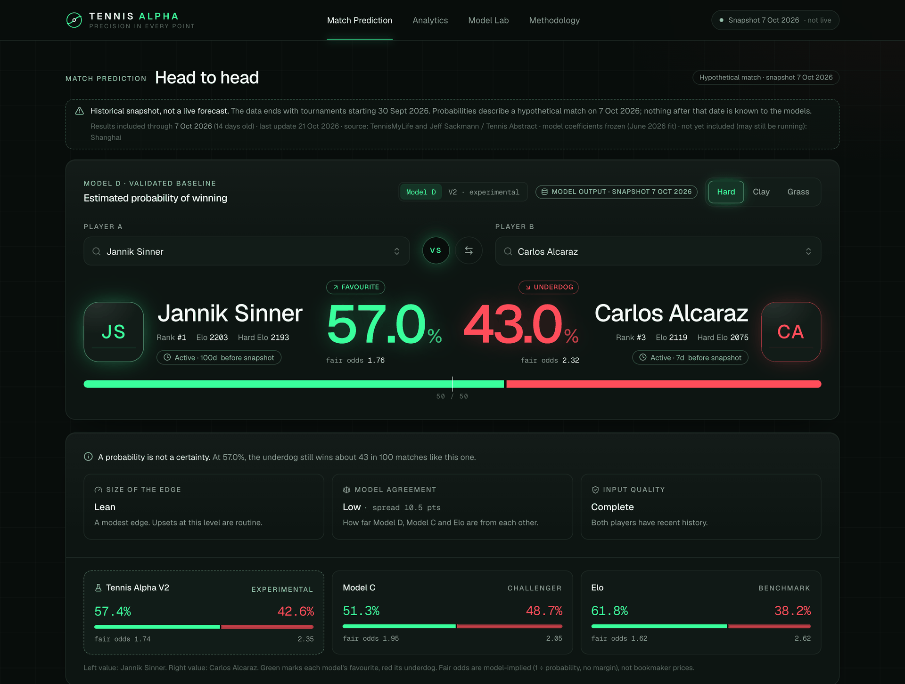
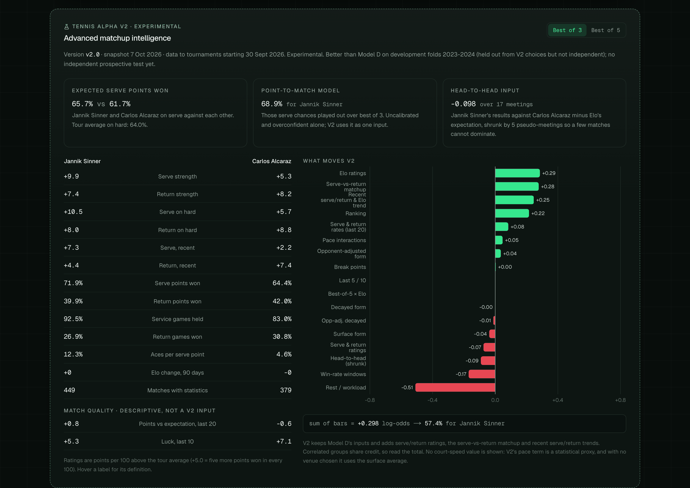
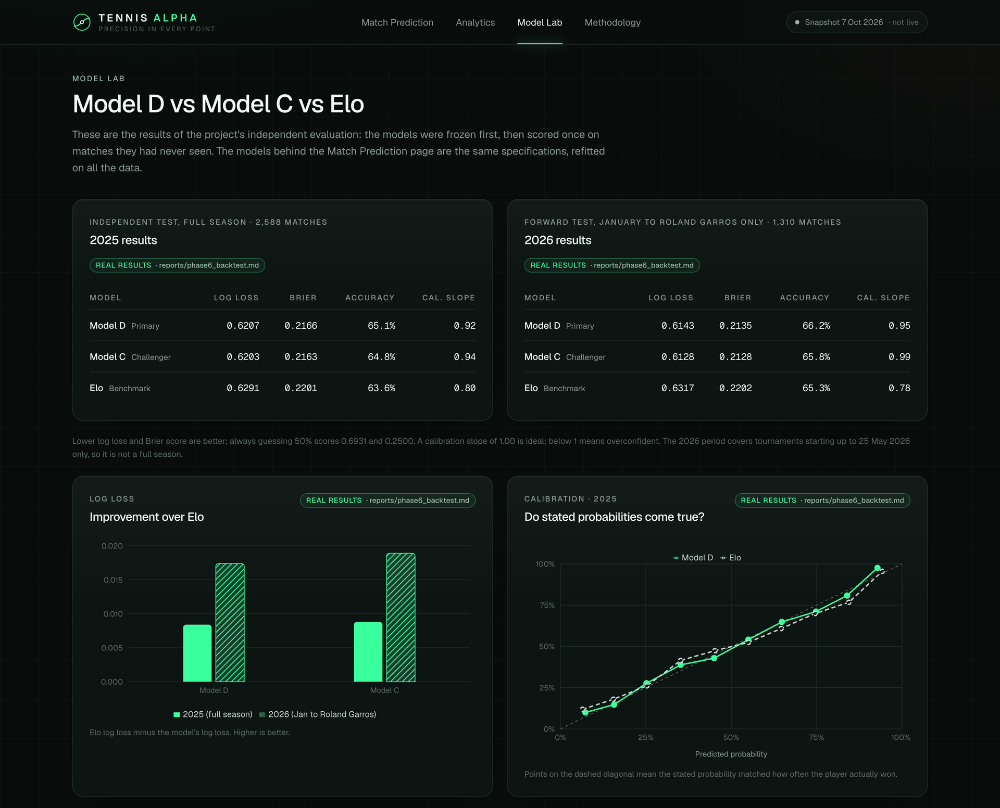

# Tennis Alpha

**Calibrated ATP match probabilities, built and tested like a quantitative research project.**

Tennis Alpha estimates the probability that one ATP player beats another before the match is played. The emphasis is on the research process as much as the model:
- pre-registered protocols;
- strict chronological evaluation with no information leakage;
- one-time out-of-sample tests;
- frozen models;
- honest reporting of results, including inconclusive ones.

It runs as a local web application on macOS, with data updated automatically each day.

**Data:** Jeff Sackmann / [Tennis Abstract](http://www.tennisabstract.com/) (2010 to May 2026, CC BY-NC-SA 4.0) and [**TennisMyLife**](https://stats.tennismylife.org) (from June 2026, used with permission). Non-commercial research only.


<sub>*Match prediction: Model D (validated baseline) with experimental V2, Model C and Elo. Fair odds are 1 ÷ probability, not bookmaker prices. Historical snapshot of 7 October 2026, not a live forecast.*</sub>

## Highlights
- **An independent test passed once, under a pre-registered rule.** Logistic-regression Model D beat an Elo benchmark on all 2,588 ATP matches of 2025: log loss 0.6207 vs 0.6291, difference −0.0083 [−0.0153, −0.0020]. Its settings were frozen before the test data was opened.
- **An advanced serve/return model (V2).** It adds opponent-adjusted serve and return ratings and a point-to-match Markov model. On held-out development seasons it improved on Model D by −0.0062 log loss [−0.0095, −0.0030].
- **A frozen forward check, reported as it came out.** On 929 later matches, V2 again beat Model D by −0.0062, but the 95% interval [−0.0165, +0.0043] includes zero: **promising, statistically inconclusive**.
- **Leakage controls enforced by tests:** 173 Python and 42 frontend automated tests, including checks that changing future results never changes past predictions.
- **A production-style local pipeline:** a daily macOS (launchd) update with validation, atomic activation, rollback and frozen coefficients. It costs nothing to run and needs no cloud.

## Research question
Before an ATP match, how well can public information predict the winner? Do recent form, opponent strength and serve/return skill add anything beyond an Elo rating?

## Models
| Model | Inputs | Role |
|---|---|---|
| **Elo** | General rating updated after each result | Benchmark |
| **Model C** | L2 logistic regression on Elo, surface Elo, ranking and recent form | Challenger |
| **Model D** | Model C plus opponent-adjusted form (result minus Elo expectation) | **Validated baseline** |
| **V2** | Model D plus serve/return ratings, a serve-vs-return matchup term, recent serve/return trends, shrunk head-to-head and a best-of-5 interaction (52 inputs) | **Experimental** |

**V2's main features:**
- **Opponent-adjusted serve and return ratings.** Each match's serve-points-won share is compared with what the opponent's return rating predicted. The results are decayed over time and shrunk toward the tour average, with a surface-level hierarchy.
- **A service-return Markov model.** It turns each player's expected serve-point win chance into a match probability, through games, tiebreak sets and best-of-3 or best-of-5. An independent solver and a simulation reproduce it.
- **Regularised logistic regression.** It combines everything, with exact player symmetry: P(A) = 1 − P(B) by construction. XGBoost was tested and was never better.


<sub>*Advanced Matchup Intelligence (V2, experimental): opponent-adjusted serve and return ratings, expected serve points won, and the feature contributions behind V2's probability.*</sub>

## Methodology and leakage prevention
- **No look-ahead.** The data has tournament start dates, not match dates. A result becomes usable only after its tournament's maximum possible length (14 days for a Grand Slam, 7 for a regular event), even for later rounds of the same event.
- **No label leakage.** Raw files list a winner and a loser. Players are therefore assigned to "A" and "B" by a hash of the match id, and every input is an A-minus-B difference.
- **Chronological splits:**
  - 2010-2014 rating warm-up;
  - 2015-2023 training;
  - 2024 validation;
  - 2025 and January-May 2026 independent tests, stored in a file the modelling code could not read until the models were frozen.
- **Pre-registration:** every protocol was committed before its results existed ([PLAN.md](PLAN.md), [PLAN_V2.md](PLAN_V2.md), [PLAN_FORWARD.md](PLAN_FORWARD.md)). The independent evaluations refuse to run a second time.
- **Uncertainty:** paired bootstrap intervals that resample whole tournaments, because matches within a tournament are correlated.

## Results
Lower log loss is better; always guessing 50% scores 0.6931.

| Evaluation | Matches | Result |
|---|---|---|
| **Independent test, 2025** (frozen models, one run) | 2,588 | Model D **0.6207** vs Elo 0.6291. Accuracy 65.1% vs 63.6% |
| Forward test, January to May 2026 (same run) | 1,310 | Model D 0.6143 vs Elo 0.6317 |
| **V2 development folds**, 2023-2024 (held out from V2's choices, not independent) | 5,559 | V2 **0.6097** vs Model D 0.6160. Difference −0.0062 [−0.0095, −0.0030] |
| **V2 retrospective hold-out**, June to October 2026 (frozen models, one run) | 929 common matches | V2 **0.6271** vs Model D **0.6333**. Difference **−0.0062**, 95% CI **[−0.0165, +0.0043]** |

**How to read the last row.** V2's improvement on new matches matches the size found in development, but 929 matches are too few to exclude chance. Under the rule fixed in advance, it is **inconclusive**. The hold-out is also retrospective: those matches were played before the models were frozen, though no outcome was used. The decisive test is prospective: predictions are logged before matches are played and scored afterwards.

**Calibration:**
- Elo is overconfident (slope 0.80 in 2025). Model D is close to calibrated (0.92).
- In an audit of 12,179 out-of-sample predictions, V2's favourites won 66.1% of the time against 67.0% predicted. Its strong favourites (above 90%) won as often as predicted.
- Both models are about 2.5 points too confident when a player has been inactive for 45+ days ([audit](reports/v2_forecast_audit.md)).

**Negative results, kept:** match-quality features, head-to-head, a court-pace proxy and recalibration added nothing measurable ([V2.1](reports/v21_dev_experiments.md)).


<sub>*Model Lab: the one-time independent test of the frozen models (2025 and January to May 2026) and their calibration.*</sub>

## The application
- **Four models side by side,** with model-implied fair odds (1 ÷ probability). These are not bookmaker prices; no betting odds are used anywhere.
- **What each prediction shows:** feature contributions that add up exactly to the prediction, an Elo history, form by window and surface, and the recorded head-to-head.
- **Advanced Matchup Intelligence:** serve and return strength, expected serve points won against this opponent, and the best-of-3 or best-of-5 matchup.
- **Honest status on every page:** a historical-snapshot notice, data age, the last update and stale-data warnings. Nothing is presented as a live forecast.

**Daily updates on macOS:**
- `./update.sh` downloads changed TennisMyLife files and rebuilds player ratings, form and serve/return profiles in a staging area.
- It validates them: coefficients identical to the frozen fit, player coverage, symmetry, and API-vs-model agreement. Only then does it activate the new files, keeping a backup.
- A launchd job runs it daily at 07:30 and at login, at most one successful check per day. Failures keep the last good data and are logged.
- **Model coefficients are never retrained automatically.**

## Run it locally
Requires macOS (or Linux), Python 3.13 and Node.js. Both services listen on this computer only.

```bash
git clone https://github.com/mateig2005/tennis-alpha.git && cd tennis-alpha
python3 -m venv .venv && .venv/bin/pip install -r requirements-lock.txt
python src/download_data.py && python src/prepare_data.py
./update.sh --force
./dev.sh
```
That clones the repository, installs the exact package versions, downloads and cleans the Sackmann history (CC BY-NC-SA), builds the player data, and starts the app at http://localhost:3100.

- **Data permission:** `./update.sh` needs TennisMyLife files, which requires your own permission from TennisMyLife. Without them, everything up to the June 2026 snapshot (all V1 and V2 research) still reproduces.
- **Daily updates:** `ops/scheduler.sh install` sets them up, `ops/scheduler.sh uninstall` removes them, and `./update.sh --status` shows the last result.
- **Prospective predictions:** log them before a tournament starts with `.venv/bin/python -m src.predlog log --a "Player A" --b "Player B" --surface Hard --tournament "Name" --tournament-start YYYY-MM-DD`. The log is private, append-only and hash-chained.

## Reproduce the research
```bash
python -m src.run_phase3 && python -m src.run_phase4 && python -m src.run_phase5
python -m src.v2.run_v2 && python -m src.v2.run_v21 && python -m src.v2.audit12
python -m unittest discover -s tests -t .
cd frontend && npm test && npm run typecheck && npm run lint
```
The first two lines run the V1 phases (Elo, form and logistic regression, XGBoost and the freeze) and the V2 development experiments, V2.1 and the forecast audit.

Every phase report and figure is in [reports/](reports/). Frozen settings are in [models/](models/) and verified by content hash ([PROVENANCE.md](PROVENANCE.md)).

## Data, licensing and attribution
- **Code:** MIT ([LICENSE](LICENSE)). This covers the original source code only.
- **Data:** not included and not covered by the MIT licence ([DATA_LICENSE.md](DATA_LICENSE.md)).
  - **Jeff Sackmann / Tennis Abstract:** ATP results and statistics 2010 to May 2026, [CC BY-NC-SA 4.0](https://creativecommons.org/licenses/by-nc-sa/4.0/).
  - **[TennisMyLife](https://stats.tennismylife.org):** ATP results and statistics from June 2026 (upstream source: the ATP). Used with the publisher's permission for this non-commercial project, including automated daily downloads on the author's computer. The data is not redistributed, and the code and app cannot rebuild it. Contact TennisMyLife before any commercial use.
- **Source quality:** TennisMyLife was validated against the Sackmann overlap ([report](reports/tml_validation.md)). 98.2% of matches linked and 100% had the same winner. Statistics agreed 96.3% raw (a failed pre-set threshold) and 98.1% after impossible values are treated as missing.

## Limitations
- **Small edges.** Model D is about 1.5 accuracy points better than Elo. V2's further gain is not yet confirmed.
- **No match dates or times.** New results wait for a tournament's maximum length, so the newest form arrives a few days late.
- **Not modelled:** injuries, withdrawals, weather, altitude and measured court speed. Absence is visible only as inactivity, and both models over-react to it slightly.
- **Data gaps:** about 19% of active players have no serve statistics, so V2 is unavailable for them. Source defects are treated as missing data, never filled in.
- **Research and education only.** This is not betting advice.

## Project structure
```
src/          data, Elo, features, models, evaluation, API, TennisMyLife adapter, refresh, sync, prediction log
src/v2/       V2 research pipeline, V2 predictor, audits, forward evaluation
frontend/     Next.js application
tests/        leakage, symmetry, chronology, artifacts, sync recovery, API
models/       frozen specifications (settings and hashes only)
reports/      phase reports and figures
ops/          launchd scheduler
```

© 2026 Matei Georgescu. Code under the MIT licence; data under its providers' terms.
