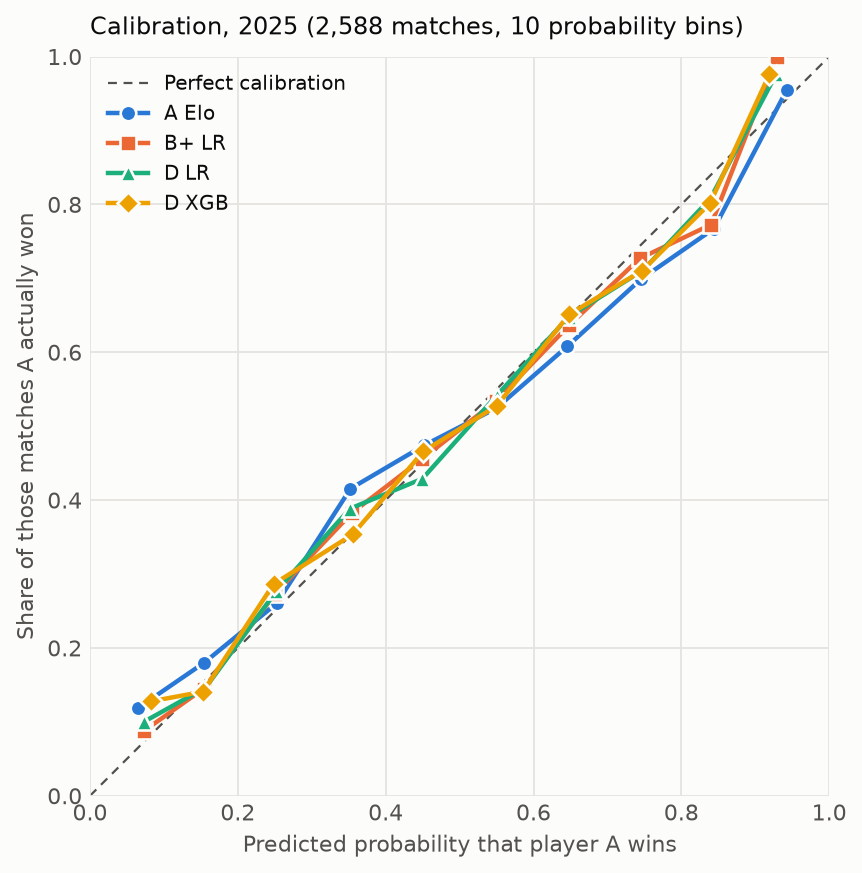
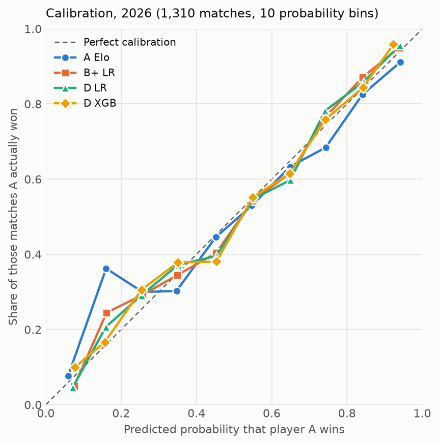

# Phase 6: independent out-of-sample evaluation, 2025 and 2026 (auto-generated by src/run_phase6.py)

Run date 2026-10-13. Code commit `05507617be7a18069ebab03cdb7872bf934d4f6e`. Nothing was tuned in this phase.

## 0. Freeze verification and reproducibility

- Frozen specification `models/frozen_phase5.json`: sha256 `16fe577b12eb96d3aae9b517802c4361b1c5a98ff9f3ae71ffbce085928a6500`, last changed in commit `f50cab2`; it and all code match the run commit (checked).
- PLAN.md sha256 `6c2b28819657b35b`; dev data `3aa4192314815326`; locked data `8e48980319a0f3ed`.
- Self-check passed: with the frozen settings, training on 2015-2023 reproduces Phase 5's 2024 log loss, Brier and accuracy for all 7 models.
- Look-ahead check passed: adding the 2025/2026 rows changed no feature or Elo value of any earlier match.
- Visibility: tournament-completion rule. Scored matches: tour-level (A/M/G/F). Elo and form update through the test period; model coefficients and trees do not.

## 2025: independent test

Trained on 25,373 tour-level matches 2015-2024. Scored: **2,588 matches** in 60 tournaments, tournament starts 2025-01-06 to 2025-12-17. Player A won 50.0% (A/B order is random).

### 2025.1 Model comparison

Lower is better for log loss, Brier, ECE. Calibration: intercept 0 and slope 1 are ideal; slope < 1 = overconfident.

| model | n | log_loss | 95% CI | brier | accuracy | ece | cal. intercept | cal. slope |
|---|---|---|---|---|---|---|---|---|
| A Elo | 2588 | 0.6291 | [0.6080, 0.6514] | 0.2201 | 0.636 | 0.0361 | -0.015 | 0.801 |
| B+ LR | 2588 | 0.6238 | [0.6046, 0.6439] | 0.2179 | 0.644 | 0.0188 | -0.008 | 0.905 |
| C LR | 2588 | 0.6203 | [0.6008, 0.6407] | 0.2163 | 0.648 | 0.0173 | -0.011 | 0.940 |
| D LR | 2588 | 0.6207 | [0.6004, 0.6418] | 0.2166 | 0.651 | 0.0199 | -0.011 | 0.918 |
| D XGB | 2588 | 0.6226 | [0.6036, 0.6425] | 0.2173 | 0.644 | 0.0197 | -0.011 | 0.906 |
| D-norank LR | 2588 | 0.6232 | [0.6034, 0.6440] | 0.2178 | 0.641 | 0.0191 | -0.012 | 0.917 |
| D-norank XGB | 2588 | 0.6235 | [0.6046, 0.6432] | 0.2177 | 0.639 | 0.0189 | -0.013 | 0.936 |

### 2025.2 Paired differences in log loss (95% interval, resampled by tournament; negative = first model better)

| tier | comparison | diff | low | high | first clearly better? |
|---|---|---|---|---|---|
| Primary | D LR minus A Elo | -0.0083 | -0.0153 | -0.0020 | yes |
| Secondary | D LR minus B+ LR | -0.0031 | -0.0061 | -0.0001 | yes |
| Secondary | D XGB minus D LR | +0.0019 | -0.0007 | +0.0043 | no |
| Secondary | D-norank LR minus A Elo | -0.0059 | -0.0116 | -0.0007 | yes |
| Exploratory | B+ LR minus A Elo | -0.0053 | -0.0116 | +0.0013 | no |
| Exploratory | C LR minus A Elo | -0.0088 | -0.0156 | -0.0023 | yes |
| Exploratory | D XGB minus A Elo | -0.0065 | -0.0141 | +0.0003 | no |
| Exploratory | D LR minus C LR | +0.0005 | -0.0013 | +0.0024 | no |
| Exploratory | C LR minus B+ LR | -0.0035 | -0.0060 | -0.0011 | yes |
| Exploratory | D-norank LR minus D LR | +0.0024 | -0.0001 | +0.0049 | no |
| Exploratory | D-norank XGB minus D-norank LR | +0.0003 | -0.0020 | +0.0024 | no |

### 2025.3 Subgroups (exploratory, log loss)

Surface:

| group | n | A Elo | B+ LR | C LR | D LR | D XGB | D-norank LR |
|---|---|---|---|---|---|---|---|
| Clay | 760 | 0.6339 | 0.6238 | 0.6195 | 0.6184 | 0.6195 | 0.6219 |
| Grass | 295 | 0.6109 | 0.6154 | 0.6098 | 0.6096 | 0.6093 | 0.6072 |
| Hard | 1533 | 0.6302 | 0.6254 | 0.6227 | 0.6240 | 0.6267 | 0.6269 |

Ranking band (best ranking of the two players):

| group | n | A Elo | B+ LR | C LR | D LR | D XGB | D-norank LR |
|---|---|---|---|---|---|---|---|
| 1: top 10 | 562 | 0.5078 | 0.4999 | 0.5016 | 0.5008 | 0.5043 | 0.5024 |
| 2: 11-30 | 740 | 0.6293 | 0.6318 | 0.6287 | 0.6314 | 0.6320 | 0.6328 |
| 3: 31-100 | 1142 | 0.6811 | 0.6710 | 0.6651 | 0.6655 | 0.6664 | 0.6694 |
| 4: 100+/unranked | 144 | 0.6888 | 0.6922 | 0.6843 | 0.6789 | 0.6884 | 0.6784 |

Quarter (by tournament start):

| group | n | A Elo | B+ LR | C LR | D LR | D XGB | D-norank LR |
|---|---|---|---|---|---|---|---|
| 2025-Q1 | 765 | 0.6361 | 0.6334 | 0.6297 | 0.6312 | 0.6350 | 0.6321 |
| 2025-Q2 | 782 | 0.6092 | 0.6025 | 0.5992 | 0.5985 | 0.5992 | 0.6004 |
| 2025-Q3 | 667 | 0.6438 | 0.6394 | 0.6342 | 0.6331 | 0.6335 | 0.6375 |
| 2025-Q4 | 374 | 0.6301 | 0.6209 | 0.6200 | 0.6239 | 0.6268 | 0.6268 |

### 2025.4 Calibration

Reliability table for the primary model (D LR):

| lo | hi | n | mean_pred | actual |
|---|---|---|---|---|
| 0.0 | 0.1 | 40 | 0.073 | 0.100 |
| 0.1 | 0.2 | 150 | 0.157 | 0.147 |
| 0.2 | 0.3 | 242 | 0.252 | 0.277 |
| 0.3 | 0.4 | 363 | 0.352 | 0.388 |
| 0.4 | 0.5 | 464 | 0.450 | 0.429 |
| 0.5 | 0.6 | 484 | 0.550 | 0.541 |
| 0.6 | 0.7 | 415 | 0.648 | 0.648 |
| 0.7 | 0.8 | 263 | 0.748 | 0.711 |
| 0.8 | 0.9 | 125 | 0.839 | 0.808 |
| 0.9 | 1.0 | 42 | 0.928 | 0.976 |

Reliability table for Elo:

| lo | hi | n | mean_pred | actual |
|---|---|---|---|---|
| 0.0 | 0.1 | 59 | 0.065 | 0.119 |
| 0.1 | 0.2 | 161 | 0.155 | 0.180 |
| 0.2 | 0.3 | 261 | 0.253 | 0.261 |
| 0.3 | 0.4 | 349 | 0.352 | 0.415 |
| 0.4 | 0.5 | 424 | 0.452 | 0.474 |
| 0.5 | 0.6 | 431 | 0.550 | 0.524 |
| 0.6 | 0.7 | 398 | 0.646 | 0.608 |
| 0.7 | 0.8 | 302 | 0.745 | 0.699 |
| 0.8 | 0.9 | 159 | 0.844 | 0.767 |
| 0.9 | 1.0 | 44 | 0.942 | 0.955 |

## 2026: forward out-of-sample (partial season)

Trained on 27,961 tour-level matches 2015-2025. Scored: **1,310 matches** in 29 tournaments, tournament starts 2026-01-04 to 2026-05-25. Player A won 49.8% (A/B order is random).
**The approved 2026 data ends with tournaments starting 2026-05-25 (Roland Garros). It is not a full season:** no grass season, no North American hard-court swing.

### 2026.1 Model comparison

Lower is better for log loss, Brier, ECE. Calibration: intercept 0 and slope 1 are ideal; slope < 1 = overconfident.

| model | n | log_loss | 95% CI | brier | accuracy | ece | cal. intercept | cal. slope |
|---|---|---|---|---|---|---|---|---|
| A Elo | 1310 | 0.6317 | [0.5933, 0.6664] | 0.2202 | 0.653 | 0.0375 | -0.022 | 0.775 |
| B+ LR | 1310 | 0.6172 | [0.5864, 0.6459] | 0.2148 | 0.660 | 0.0269 | -0.021 | 0.963 |
| C LR | 1310 | 0.6128 | [0.5816, 0.6416] | 0.2128 | 0.658 | 0.0243 | -0.019 | 0.988 |
| D LR | 1310 | 0.6143 | [0.5830, 0.6438] | 0.2135 | 0.662 | 0.0338 | -0.021 | 0.947 |
| D XGB | 1310 | 0.6149 | [0.5829, 0.6446] | 0.2135 | 0.662 | 0.0319 | -0.022 | 0.960 |
| D-norank LR | 1310 | 0.6173 | [0.5865, 0.6466] | 0.2146 | 0.660 | 0.0222 | -0.021 | 0.941 |
| D-norank XGB | 1310 | 0.6192 | [0.5884, 0.6484] | 0.2152 | 0.666 | 0.0311 | -0.025 | 0.958 |

### 2026.2 Paired differences in log loss (95% interval, resampled by tournament; negative = first model better)

| tier | comparison | diff | low | high | first clearly better? |
|---|---|---|---|---|---|
| Primary | D LR minus A Elo | -0.0174 | -0.0289 | -0.0046 | yes |
| Secondary | D LR minus B+ LR | -0.0029 | -0.0071 | +0.0020 | no |
| Secondary | D XGB minus D LR | +0.0006 | -0.0026 | +0.0034 | no |
| Secondary | D-norank LR minus A Elo | -0.0145 | -0.0249 | -0.0019 | yes |
| Exploratory | B+ LR minus A Elo | -0.0145 | -0.0251 | -0.0028 | yes |
| Exploratory | C LR minus A Elo | -0.0190 | -0.0304 | -0.0065 | yes |
| Exploratory | D XGB minus A Elo | -0.0169 | -0.0279 | -0.0053 | yes |
| Exploratory | D LR minus C LR | +0.0015 | -0.0011 | +0.0042 | no |
| Exploratory | C LR minus B+ LR | -0.0045 | -0.0074 | -0.0015 | yes |
| Exploratory | D-norank LR minus D LR | +0.0030 | +0.0001 | +0.0058 | worse |
| Exploratory | D-norank XGB minus D-norank LR | +0.0019 | -0.0017 | +0.0050 | no |

### 2026.3 Subgroups (exploratory, log loss)

Surface:

| group | n | A Elo | B+ LR | C LR | D LR | D XGB | D-norank LR |
|---|---|---|---|---|---|---|---|
| Clay | 651 | 0.6530 | 0.6304 | 0.6228 | 0.6225 | 0.6255 | 0.6270 |
| Hard | 659 | 0.6108 | 0.6042 | 0.6028 | 0.6062 | 0.6044 | 0.6077 |

Ranking band (best ranking of the two players):

| group | n | A Elo | B+ LR | C LR | D LR | D XGB | D-norank LR |
|---|---|---|---|---|---|---|---|
| 1: top 10 | 265 | 0.5205 | 0.5133 | 0.5091 | 0.5071 | 0.5088 | 0.5077 |
| 2: 11-30 | 432 | 0.6223 | 0.6115 | 0.6101 | 0.6131 | 0.6141 | 0.6169 |
| 3: 31-100 | 564 | 0.6857 | 0.6668 | 0.6610 | 0.6638 | 0.6627 | 0.6656 |
| 4: 100+/unranked | 49 | 0.6960 | 0.6585 | 0.6421 | 0.6351 | 0.6454 | 0.6564 |

Quarter (by tournament start):

| group | n | A Elo | B+ LR | C LR | D LR | D XGB | D-norank LR |
|---|---|---|---|---|---|---|---|
| 2026-Q1 | 824 | 0.6251 | 0.6136 | 0.6104 | 0.6124 | 0.6122 | 0.6149 |
| 2026-Q2 | 486 | 0.6431 | 0.6234 | 0.6167 | 0.6176 | 0.6194 | 0.6212 |

### 2026.4 Calibration

Reliability table for the primary model (D LR):

| lo | hi | n | mean_pred | actual |
|---|---|---|---|---|
| 0.0 | 0.1 | 22 | 0.071 | 0.045 |
| 0.1 | 0.2 | 58 | 0.159 | 0.207 |
| 0.2 | 0.3 | 158 | 0.254 | 0.291 |
| 0.3 | 0.4 | 188 | 0.351 | 0.372 |
| 0.4 | 0.5 | 225 | 0.453 | 0.396 |
| 0.5 | 0.6 | 226 | 0.553 | 0.549 |
| 0.6 | 0.7 | 206 | 0.649 | 0.597 |
| 0.7 | 0.8 | 133 | 0.742 | 0.782 |
| 0.8 | 0.9 | 71 | 0.844 | 0.859 |
| 0.9 | 1.0 | 23 | 0.940 | 0.957 |

Reliability table for Elo:

| lo | hi | n | mean_pred | actual |
|---|---|---|---|---|
| 0.0 | 0.1 | 26 | 0.059 | 0.077 |
| 0.1 | 0.2 | 69 | 0.160 | 0.362 |
| 0.2 | 0.3 | 160 | 0.257 | 0.300 |
| 0.3 | 0.4 | 195 | 0.347 | 0.303 |
| 0.4 | 0.5 | 193 | 0.451 | 0.446 |
| 0.5 | 0.6 | 221 | 0.547 | 0.529 |
| 0.6 | 0.7 | 180 | 0.649 | 0.633 |
| 0.7 | 0.8 | 152 | 0.743 | 0.684 |
| 0.8 | 0.9 | 80 | 0.841 | 0.825 |
| 0.9 | 1.0 | 34 | 0.942 | 0.912 |

## Reproducibility

Predictions for every scored match: `data/processed/phase6_predictions.csv` (not committed: derived from CC BY-NC-SA data), sha256 `66e14fe4cbe8fdf8e073cd857757a6627a2eba74b5f9e915fa0f7ed0dc205d18`.
