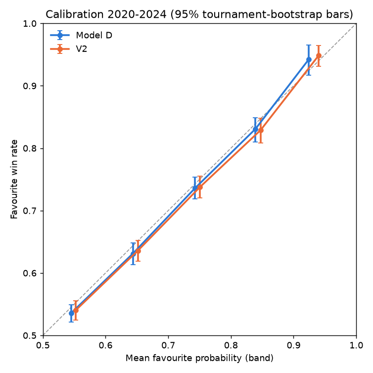

# V2 forecast audit (auto-generated by src/v2/audit12.py)

Development data only (2025/2026 not read). 12,179 tour-level matches from 2020-2024. Each one is predicted by a model fitted on 2015 to the previous year, using the **frozen** settings, so these are the out-of-sample predictions the models would have made. Intervals resample whole tournaments (2,000 draws). `gap` = observed favourite win rate minus mean favourite probability: **negative = overconfident**. 2020-2022 helped choose V2's C, so they flatter V2 slightly; 2023-2024 did not.

Check that the frozen fits reproduce the stage 1 numbers (2023-2024 log loss):

| model | n | log_loss |
|---|---|---|
| Model D | 5559 | 0.6160 |
| V2 | 5559 | 0.6097 |
| V2 (C=0.01) | 5559 | 0.6099 |
| V2.1 | 5559 | 0.6098 |

## 1. Extreme probabilities: is V2 overconfident?

How often each model names a strong favourite:

| model | favourite > 60% | favourite > 70% | favourite > 80% | favourite > 90% | mean_abs_logodds |
|---|---|---|---|---|---|
| Model D | 64.8% | 35.3% | 14.5% | 3.0% | 0.750 |
| V2 | 66.1% | 37.1% | 16.3% | 4.3% | 0.794 |

Calibration by favourite band (all 2020-2024 predictions):

**Model D**

| band | n | predicted | observed | gap | low | high |
|---|---|---|---|---|---|---|
| 50%-60% | 4290 | 54.9% | 53.6% | -0.0134 | -0.0281 | +0.0003 |
| 60%-70% | 3591 | 64.8% | 63.1% | -0.0165 | -0.0343 | +0.0003 |
| 70%-80% | 2531 | 74.7% | 73.6% | -0.0108 | -0.0283 | +0.0069 |
| 80%-90% | 1401 | 84.3% | 83.1% | -0.0123 | -0.0334 | +0.0055 |
| 90%-100% | 366 | 92.8% | 94.3% | +0.0142 | -0.0119 | +0.0372 |

**V2**

| band | n | predicted | observed | gap | low | high |
|---|---|---|---|---|---|---|
| 50%-60% | 4133 | 54.8% | 54.0% | -0.0082 | -0.0242 | +0.0070 |
| 60%-70% | 3523 | 64.8% | 63.6% | -0.0117 | -0.0284 | +0.0048 |
| 70%-80% | 2542 | 74.7% | 73.8% | -0.0089 | -0.0265 | +0.0088 |
| 80%-90% | 1455 | 84.3% | 82.9% | -0.0145 | -0.0350 | +0.0043 |
| 90%-100% | 526 | 93.6% | 94.9% | +0.0126 | -0.0048 | +0.0282 |

By situation:

| group | model | n | predicted | observed | gap | low | high | log_loss | cal_slope |
|---|---|---|---|---|---|---|---|---|---|
| all development matches | Model D | 12179 | 66.4% | 65.2% | -0.0129 | -0.0225 | -0.0042 | 0.6145 | 0.945 |
| all development matches | V2 | 12179 | 67.0% | 66.1% | -0.0092 | -0.0187 | -0.0013 | 0.6061 | 0.953 |
| top-10 v top-10 | Model D | 265 | 65.1% | 63.8% | -0.0135 | -0.0658 | +0.0440 | 0.6234 | 1.009 |
| top-10 v top-10 | V2 | 265 | 65.1% | 63.8% | -0.0133 | -0.0653 | +0.0405 | 0.6095 | 1.102 |
| top-20 v top-20 | Model D | 725 | 65.9% | 62.9% | -0.0303 | -0.0622 | +0.0011 | 0.6209 | 0.959 |
| top-20 v top-20 | V2 | 725 | 66.0% | 64.4% | -0.0163 | -0.0484 | +0.0155 | 0.6044 | 1.061 |
| comparable strength (Elo gap < 50) | Model D | 3003 | 57.0% | 54.3% | -0.0270 | -0.0438 | -0.0112 | 0.6827 | 0.800 |
| comparable strength (Elo gap < 50) | V2 | 3003 | 58.2% | 57.3% | -0.0086 | -0.0255 | +0.0079 | 0.6733 | 0.944 |
| surface: Hard | Model D | 7272 | 67.1% | 65.8% | -0.0135 | -0.0240 | -0.0029 | 0.6082 | 0.949 |
| surface: Hard | V2 | 7272 | 67.5% | 66.7% | -0.0084 | -0.0189 | +0.0019 | 0.6010 | 0.959 |
| surface: Clay | Model D | 3648 | 65.8% | 63.9% | -0.0183 | -0.0381 | -0.0010 | 0.6285 | 0.879 |
| surface: Clay | V2 | 3648 | 66.0% | 64.5% | -0.0155 | -0.0325 | +0.0011 | 0.6204 | 0.912 |
| surface: Grass | Model D | 1259 | 64.6% | 65.2% | +0.0065 | -0.0244 | +0.0291 | 0.6103 | 1.157 |
| surface: Grass | V2 | 1259 | 67.1% | 67.6% | +0.0046 | -0.0236 | +0.0255 | 0.5935 | 1.033 |
| best of 3 | Model D | 9734 | 65.8% | 63.5% | -0.0228 | -0.0315 | -0.0140 | 0.6325 | 0.861 |
| best of 3 | V2 | 9734 | 65.6% | 64.4% | -0.0116 | -0.0211 | -0.0017 | 0.6247 | 0.936 |
| best of 5 | Model D | 2445 | 69.2% | 71.8% | +0.0267 | +0.0062 | +0.0459 | 0.5428 | 1.243 |
| best of 5 | V2 | 2445 | 73.0% | 73.0% | +0.0004 | -0.0189 | +0.0179 | 0.5317 | 0.993 |
| a player inactive 45+ days | Model D | 2911 | 69.8% | 67.3% | -0.0253 | -0.0440 | -0.0079 | 0.5976 | 0.879 |
| a player inactive 45+ days | V2 | 2911 | 70.1% | 67.4% | -0.0271 | -0.0445 | -0.0102 | 0.5900 | 0.893 |
| model's own favourite > 70% | Model D | 4298 | 79.4% | 78.5% | -0.0092 | -0.0233 | +0.0044 | 0.5052 | 0.963 |
| model's own favourite > 70% | V2 | 4523 | 80.0% | 79.2% | -0.0082 | -0.0208 | +0.0042 | 0.4929 | 0.965 |
| model's own favourite > 80% | Model D | 1767 | 86.1% | 85.4% | -0.0068 | -0.0246 | +0.0084 | 0.4053 | 0.974 |
| model's own favourite > 80% | V2 | 1981 | 86.8% | 86.1% | -0.0073 | -0.0216 | +0.0078 | 0.3878 | 0.980 |
| model's own favourite > 90% | Model D | 366 | 92.8% | 94.3% | +0.0142 | -0.0119 | +0.0372 | 0.2190 | 1.114 |
| model's own favourite > 90% | V2 | 526 | 93.6% | 94.9% | +0.0126 | -0.0048 | +0.0282 | 0.1982 | 1.091 |

Why V2 is more confident: mean contribution toward V2's favourite (log-odds) by feature group, in 1,042 of 5,559 2023-2024 matches where V2's favourite probability exceeds Model D's by more than 5 points, against all others (V2 fitted 2015-2022):

| group | V2 > D by 5+ pts | other matches |
|---|---|---|
| momentum | +0.331 | +0.199 |
| elo | +0.269 | +0.318 |
| matchup | +0.187 | +0.103 |
| context | +0.141 | +0.033 |
| rank | +0.120 | +0.143 |
| sr_adj | +0.106 | +0.081 |
| rest | +0.030 | +0.045 |
| pace | +0.024 | -0.003 |
| sr_raw | +0.011 | +0.001 |
| h2h | +0.008 | +0.002 |
| adj | +0.006 | +0.031 |
| dec | +0.000 | +0.000 |
| adjdec | -0.002 | -0.007 |
| pressure | -0.006 | -0.019 |
| surf | -0.046 | -0.055 |
| last | -0.051 | -0.060 |
| win | -0.074 | -0.086 |

## 2. The service-return (Markov) model

**Independent verification.** A separate solver (explicit server tracking, generic tiebreak length) and a point-by-point simulation (20,000 matches each) against the production formulas:

| pa | pb | best_of | production | independent | abs_diff | simulated | sim_se | final_tb10 |
|---|---|---|---|---|---|---|---|---|
| 0.64 | 0.58 | 3 | 0.779035 | 0.779035 | 1.1e-16 | 0.7770 | 0.0029 | 0.780173 |
| 0.64 | 0.58 | 5 | 0.831687 | 0.831687 | 1.1e-16 | 0.8263 | 0.0026 | 0.832410 |
| 0.7 | 0.6 | 3 | 0.891012 | 0.891012 | 2.2e-16 | 0.8896 | 0.0022 | 0.892608 |
| 0.62 | 0.62 | 5 | 0.500000 | 0.500000 | 4.4e-16 | 0.5008 | 0.0035 | 0.500000 |
| 0.55 | 0.68 | 3 | 0.049195 | 0.049195 | 1.1e-16 | 0.0501 | 0.0015 | 0.048376 |
| 0.66 | 0.63 | 5 | 0.679187 | 0.679187 | 5.6e-16 | 0.6734 | 0.0033 | 0.679870 |

`final_tb10` = the same match with a 10-point tiebreak at 6-6 in the deciding set (Grand Slam rule since 2022).

**How a small point edge grows** (both players around 63% on serve):

| point_edge | A_hold | B_hold | set | match_bo3 | match_bo5 |
|---|---|---|---|---|---|
| 0.0000 | 0.7947 | 0.7947 | 0.5000 | 0.5000 | 0.5000 |
| 0.0100 | 0.8038 | 0.7854 | 0.5335 | 0.5501 | 0.5626 |
| 0.0200 | 0.8126 | 0.7759 | 0.5667 | 0.5995 | 0.6236 |
| 0.0400 | 0.8296 | 0.7562 | 0.6316 | 0.6928 | 0.7356 |
| 0.0600 | 0.8457 | 0.7357 | 0.6929 | 0.7750 | 0.8274 |
| 0.0800 | 0.8609 | 0.7145 | 0.7492 | 0.8429 | 0.8957 |

**Are the point-level inputs too spread out?** On 12,099 matches with statistics, regressing the observed serve-point gap (A minus B) on the predicted gap gives slope **1.13**; for A's serve share alone, **1.02**. A slope of 1 means the predicted serve/return differences are the right size on average; above 1, slightly too small; below 1, too large. So the point-level inputs are **not** too spread out: the overconfidence of the raw matchup probability below comes from the point-to-match step, which treats each player's serve chance as fixed and known for the whole match. In reality it varies from day to day, which makes results less predictable than the formula assumes. V2's regression gives the matchup term a reduced weight, which corrects for this.

**Raw matchup probability on its own** (it is one V2 input, not V2's output):

| format | n | predicted | observed | gap | low | high | log_loss | cal_slope |
|---|---|---|---|---|---|---|---|---|
| best of 3 | 9734 | 68.0% | 63.3% | -0.0478 | -0.0576 | -0.0381 | 0.6457 | 0.681 |
| best of 5 | 2445 | 74.5% | 70.8% | -0.0371 | -0.0505 | -0.0254 | 0.5465 | 0.826 |

**Correlated inputs (possible double counting).** Correlations between the matchup log-odds and the serve/return, Elo and form differences:

| feature | mk | srv | ret | srv_s | ret_s | srv60 | ret60 | elo | surf_elo | dec_wr_60 |
|---|---|---|---|---|---|---|---|---|---|---|
| mk | 1.0 | 0.71 | 0.63 | 0.74 | 0.67 | 0.67 | 0.6 | 0.86 | 0.86 | 0.72 |
| srv | 0.71 | 1.0 | 0.03 | 0.95 | 0.02 | 0.92 | 0.06 | 0.71 | 0.62 | 0.59 |
| ret | 0.63 | 0.03 | 1.0 | 0.01 | 0.94 | 0.06 | 0.92 | 0.62 | 0.53 | 0.5 |
| srv_s | 0.74 | 0.95 | 0.01 | 1.0 | 0.02 | 0.88 | 0.04 | 0.66 | 0.66 | 0.56 |
| ret_s | 0.67 | 0.02 | 0.94 | 0.02 | 1.0 | 0.05 | 0.87 | 0.57 | 0.58 | 0.48 |
| srv60 | 0.67 | 0.92 | 0.06 | 0.88 | 0.05 | 1.0 | 0.12 | 0.67 | 0.57 | 0.69 |
| ret60 | 0.6 | 0.06 | 0.92 | 0.04 | 0.87 | 0.12 | 1.0 | 0.59 | 0.49 | 0.61 |
| elo | 0.86 | 0.71 | 0.62 | 0.66 | 0.57 | 0.67 | 0.59 | 1.0 | 0.87 | 0.77 |
| surf_elo | 0.86 | 0.62 | 0.53 | 0.66 | 0.58 | 0.57 | 0.49 | 0.87 | 1.0 | 0.65 |
| dec_wr_60 | 0.72 | 0.59 | 0.5 | 0.56 | 0.48 | 0.69 | 0.61 | 0.77 | 0.65 | 1.0 |

Variance inflation factors above 10 (V2 features):

| feature | vif |
|---|---|
| spw | 259.3 |
| fwon | 177.2 |
| wr10 | 146.2 |
| elo | 121.8 |
| mk | 113.4 |
| dec_wr_60 | 109.1 |
| adj10 | 98.4 |
| srv_s | 78.3 |
| rpw | 67.8 |
| ret_s | 60.4 |
| adj_dec_60 | 58.9 |
| wr90 | 48.8 |
| adj90 | 43.3 |
| wr365 | 35.5 |
| swon | 35.1 |
| srv | 33.8 |
| lrank | 33.6 |
| lpts | 28.2 |
| ret | 27.8 |
| r1 | 26.3 |
| hold | 25.3 |
| opp10 | 21.3 |
| brk | 18.0 |
| fin | 15.4 |
| adj365 | 14.2 |
| r2 | 13.7 |
| srv60 | 12.7 |
| ret60 | 11.3 |
| surf_elo | 10.8 |

## 3. Model uncertainty

**Parameter uncertainty.** V2 refitted 30 times on 2015-2023, resampling whole training tournaments; spread (standard deviation) of each 2024 prediction across refits:

| rows | n | median_sd | p90_sd | max_sd |
|---|---|---|---|---|
| all 2024 matches | 2813 | 0.0181 | 0.0248 | 0.0548 |
| top-10 v top-10 | 60 | 0.0201 | 0.0266 | 0.0371 |

Sinner vs Alcaraz meetings in 2024 (development data), Sinner's side: Model D, V2, the bootstrap range of V2 and V2.1. Tournament start dates:

| start | surface | round_rank | D | V2 | V2_boot_2_5 | V2_boot_97_5 | V21 | sinner_won |
|---|---|---|---|---|---|---|---|---|
| 2024-03-04 | Hard | 6 | 72.4% | 63.9% | 60.3% | 68.9% | 63.1% | 0 |
| 2024-05-27 | Clay | 6 | 54.4% | 60.1% | 56.2% | 64.7% | 61.4% | 0 |
| 2024-09-26 | Hard | 7 | 67.1% | 62.2% | 58.7% | 66.1% | 62.4% | 0 |

**Feature-set and regularisation uncertainty.** Per-match disagreement between models of similar overall accuracy (2023-2024):

| pair | rows | n | mean | p90 | max | share_over_5pts |
|---|---|---|---|---|---|---|
| V2 vs V2.1 | all | 5559 | 0.0114 | 0.0247 | 0.0737 | 0.2% |
| V2 vs V2.1 | top-10 v top-10 | 124 | 0.0122 | 0.0263 | 0.0449 | 0.0% |
| V2 vs V2 (C=0.01) | all | 5559 | 0.0049 | 0.0102 | 0.0465 | 0.0% |
| V2 vs V2 (C=0.01) | top-10 v top-10 | 124 | 0.0068 | 0.0132 | 0.0301 | 0.0% |
| V2 vs Model D | all | 5559 | 0.0442 | 0.0920 | 0.2379 | 35.5% |
| V2 vs Model D | top-10 v top-10 | 124 | 0.0432 | 0.0840 | 0.1487 | 37.1% |

## 4. Findings

1. **V2 is not systematically overconfident.** Over 2020-2024 its favourites won 66.1% against 67.0% predicted (gap -0.009); Model D: -0.013. Both lean about one point too confident in the 50-90% bands; above 90%, V2's favourites won slightly *more* often than predicted.
2. **Stronger favourites are mostly justified.** V2 names more 80%+ favourites (16.3% vs 14.5%) and they win at the predicted rate. In best-of-5, Model D is *under*confident (gap +0.027) while V2 is on target (+0.000): V2's best-of-5 × Elo and matchup terms capture that longer matches favour the stronger player.
3. **Elite matchups:** top-10 v top-10 has only 265 matches; V2's gap is -0.013 with interval [-0.065, +0.040]. No overconfidence can be shown, and none can be ruled out at the size of a few points.
4. **The one consistent weakness: inactivity.** With a player inactive 45+ days, Model D is 2.5% and V2 2.7% too confident, both intervals excluding 0. This is the Sinner-Alcaraz situation, so the June 2026 probabilities are probably a few points too high for the active player.
5. **The scoring model is mathematically correct** (independent solver agrees to 1e-15; simulation within its error). The Slam 10-point final-set tiebreak changes results by at most about 0.2 points. Used raw, it is overconfident because serve chances vary within and between matches; V2 down-weights it, and V2's own calibration (points 1-2) shows the correction works.
6. **Correlated features** (matchup term vs Elo r = 0.86; variance inflation up to about 260) make single coefficients unstable, not the probabilities. That is why group contributions should be read together, and why parameter uncertainty is visible.
7. **Uncertainty of a single prediction.** Refitting on resampled tournaments moves a typical 2024 prediction by about 1.8% (standard deviation), so roughly ±4% at 95%, from parameters alone. V2 and V2.1 differ by 1.1% on average, and by more than 5 points in only 0.2% of matches. The 4.7-point Sinner-Alcaraz gap is in that rare tail, driven by Alcaraz's absence (correlated workload inputs). These are defensible parameter-only intervals. They do not include missing context (injuries, conditions), so they are not shown in the app as 'confidence intervals'.
